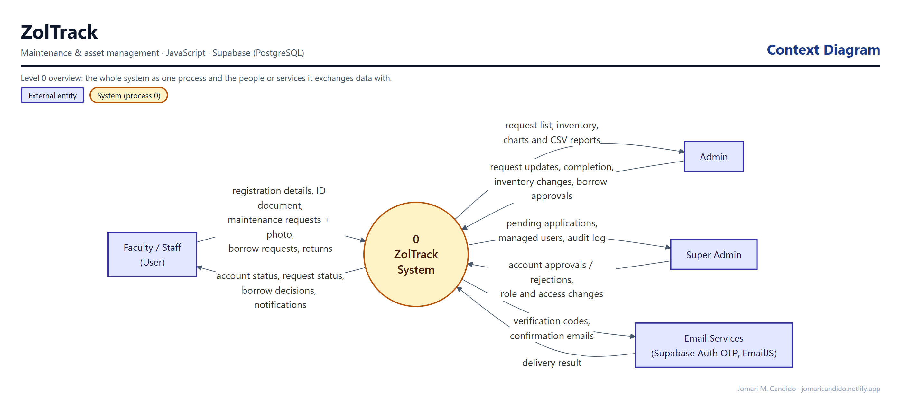
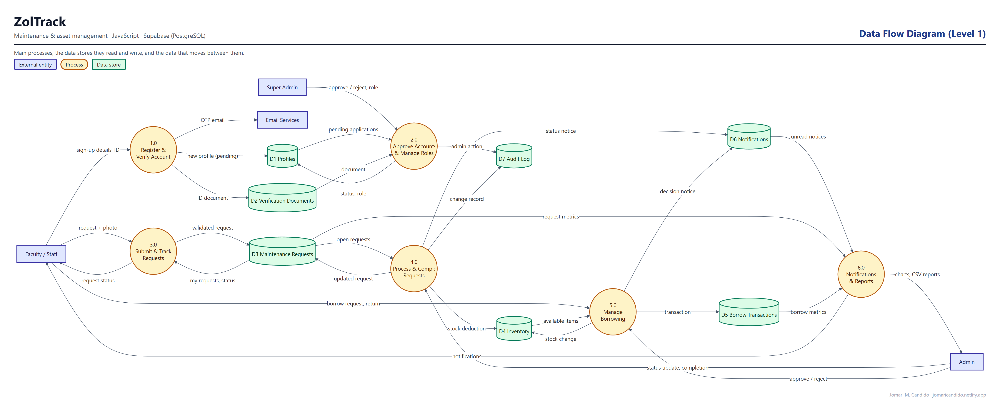
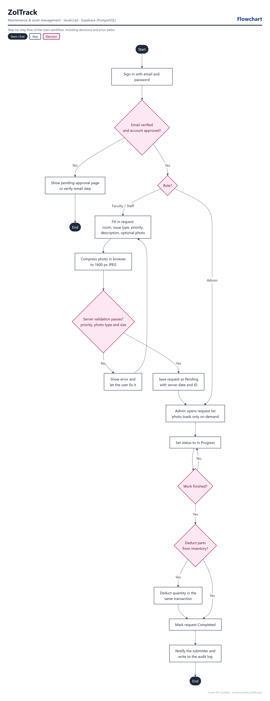

# ZolTrack

**Maintenance & Asset Management System**

ZolTrack is a web-based system for school facilities that centralizes maintenance requests, inventory, asset borrowing, account approval, notifications, audit history, and operational reporting.

## Live Demo

**[Open ZolTrack](https://zoltrack.netlify.app/)**

## Highlights

- Role-based workflows for User, Admin, and Super Admin accounts
- Supabase Auth with email confirmation and profile approval
- Private verification-document storage with controlled access
- Maintenance request tracking with server-generated request IDs
- Request photos compressed in the browser and loaded only when opened
- Atomic maintenance completion and inventory deduction
- Inventory and borrowing workflows with approval and return handling
- Persistent in-app notifications and audit logging
- Dashboard metrics, charts, and CSV reporting
- Responsive dark-themed interface

## System design

These diagrams were drawn from the app's actual database schema, roles and code paths.

**Context diagram.** ZolTrack as a single process, and the people and outside services it exchanges data with.



**Data flow diagram (Level 1).** The main processes, the data stores they read and write (grouped from the database tables), and the data that moves between them.



**Flowchart: maintenance request lifecycle.** The main workflow step by step, including decisions and error paths.



## Tech Stack

- HTML5, CSS3, JavaScript
- Supabase / PostgreSQL
- Supabase Auth, Storage, Row Level Security, and PostgreSQL RPC functions
- EmailJS for application notification emails
- Brevo SMTP for authentication email delivery
- Chart.js
- SweetAlert2
- Netlify

## Security Design

ZolTrack uses Supabase Row Level Security and server-side PostgreSQL functions for privileged operations. User-owned records are scoped to authenticated identities, while administrative actions validate roles server-side. Request priority, photo type and photo size are validated in the database, and all user-entered text is escaped before it is shown. Verification documents are stored in a private bucket.

> Frontend Supabase anon/publishable credentials and EmailJS public identifiers are client-visible by design. Private SMTP credentials, service-role keys, and passwords must never be committed to this repository.

## Database

The `supabase/` directory contains the staged SQL migrations used during development, including authentication migration, RLS hardening, legacy-auth retirement, atomic maintenance completion, private verification storage, persistent notifications/audit logging, reporting functions, and on-demand request photos with input validation (`V10_2_REQUEST_PHOTOS_AND_INPUT_HARDENING.sql`).

## Local Use

This project is a static frontend and can be served with any local web server. The deployed application depends on its configured Supabase project and external email services.

## Testing

28 automated tests run with the Node.js test runner and a fake Supabase client, so no network or database is used. They cover HTML escaping, maintenance, approval and borrowing workflows, the read cache, and password recovery.

```sh
node --test tests/escaping.test.cjs tests/workflows.test.cjs tests/password-recovery.test.cjs
```

## Author

**Jomari M. Candido**
Sole Software Developer

## Project Status

Portfolio release — ZolTrack v10.2, live on Netlify and deployed from this repository.
